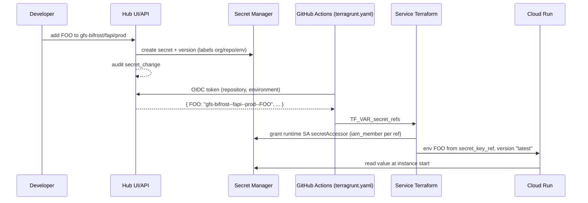

# Secrets Hub — Overview

<!-- The narrative and the verdict. PROGRESS lives in the Migration State doc, not here — link it,
     never duplicate its ledger. This doc changes rarely; the state doc changes every session. -->

## Deliverables
- [[Secrets Hub/Migration State|Migration State]]: the live source of truth for progress.
- **New hub repo** `gfs-bifrost/secrets-hub` (working name): a small API on Cloud Run plus our own UI on ui-toolkit. It owns the access
  model, writes to GCP Secret Manager, and emits audit events.
- **`ilg-platform/github-actions`**: an optional secrets step in the reusable `terragrunt.yaml` that
  mints the GitHub OIDC token, asks the hub for references and exports `TF_VAR_secret_refs`.
- **`@gfs-bifrost/audit`**: a `secret_change` kind (approved, Harry 2026-10-13).
- **Each service ("spoke")**: about 15 lines of Terraform, added once.
- Out-of-ticket for now. No Jira epic yet.

## Verdict
**Go with conditions** (Harry, 2026-10-13). The design below was agreed in conversation. Build starts
unit by unit. G1–G5 are answered; G6 (developer login, write groups, value display) blocks the UI.

## The problem
- Developers find GCP Secret Manager painful to use directly: the console, the naming, and the IAM.
- Today secrets reach services as Terraform variables. `terragrunt.yaml` takes up to five
  `tf_var_extra_N` values from GitHub secrets, and injects `TF_VAR_datadog_api_key_*` the same way.
  Those values land in Terraform state.
  - Examples: `terraform-modules`' `compute/cloud-run` passes `DD_API_KEY` as a plain env value, so it
    sits in state ([[terraform-modules/architecture]]). fapi reads the config-service API key through
    a `google_secret_manager_secret_version` data source, which also stores the value in fapi's state.
- State is widely readable. Each environment's deployer reads the other environment's whole state
  ([[core-infra/architecture]], Security notes).
- There is no single place to see, add or rotate a repo's secrets, and no audit trail of who changed what.

## Access model
> SUPERSEDED 2026-10-13 — shared secrets are per environment (`<org>/_shared/<env>/<KEY>`), and each environment runs its own hub that manages only its own project. See the Migration State decision log and [[secrets-hub/plans/hub-ci-read-path]].
Paths are `<org>/<repo>/<env>/<KEY>`, plus org-wide shared secrets.

| Who | How they prove it | What they can do |
| --- | --- | --- |
| A repo's CI job | GitHub Actions OIDC token, checked by the hub | List the **names** in its own `<org>/<repo>/<env>`, plus `<org>/_shared`. Never values. |
| Developer | UI login (G6) | Write secrets for repos and environments their group allows. Prod writes need a narrower group. |
| Cloud Run runtime service account | Secret Manager IAM | Read the values of the secrets granted to it. The only reader of values. |

- **The repo scope comes from GitHub, not from the hub.** The OIDC token's `repository` claim is already
  `org/repo`, and its `environment` claim names the GitHub environment. The hub verifies the token
  against GitHub's signing keys, checks `aud` is the hub's own URL, and maps the claims to a path.
- **Environment mapping is explicit.** Apply jobs run under `terraform-dev` and `terraform-prod`, so
  that is what the claim says. The hub maps those names to `dev` and `prod`.
- **PR plans** run without an environment (`sub` is `repo:<org>/<repo>:pull_request`). They list dev's
  names (G5).
- **Trusted orgs** are the three the WIF pool trusts today: `gfs-bifrost`, `ilg-platform` and
  `ilg-tech-services` ([[core-infra/architecture]]).

## Storage: GCP Secret Manager, behind the hub
Secret Manager stays the store. Nobody uses it directly; the hub and Cloud Run are its only clients.
It already provides what a homegrown store would have to build: encryption, versioning, IAM, its own
audit logs, and native Cloud Run references.

> SUPERSEDED 2026-10-13 — the codec hex-escapes `.` and `_` in the repo segment, and shared IDs carry the environment (`<org>--_shared--<env>--<KEY>`). [[secrets-hub/plans/hub-ci-read-path]] increment 4 owns it.
- **Naming.** Secret IDs can't contain `/`, so the path is encoded:
  - `<org>--<repo>--<env>--<KEY>`, e.g. `gfs-bifrost--fapi--prod--CONFIG_SERVICE_API_KEY`
  - `<org>--_shared--<KEY>`
- **Labels** `org`, `repo` and `env` on each secret, so listing filters by label rather than parsing names.
- **Project.** Each environment's own GCP project, not a central one, so there's no cross-project IAM.
- **Secret Manager data-access audit logs are turned on.** They back up the hub's own audit events,
  because the `@gfs-bifrost/audit` publisher never blocks the action it records.

## Deploy flow
The CI job passes **references**, never values. Nothing sensitive reaches state, plan files, logs or
the Cloud Run revision.



1. A developer adds `FOO` in the UI. The hub creates the secret with its labels, adds the value as a
   version, and emits a `secret_change` audit event.
2. On deploy, the reusable workflow's secrets step mints the OIDC token, calls the hub and exports the
   returned map as `TF_VAR_secret_refs`. It is one dedicated input, not one of the five
   `tf_var_extra_N` slots.
3. The service's Terraform grants its runtime service account access to each referenced secret, then
   wires each one into Cloud Run as a `secret_key_ref` with version `latest`.
4. Cloud Run reads the values at instance start.

**After the one-time setup, adding a secret is: add it in the UI, then redeploy.** No Terraform edit, no
PR and no IAM request.

## Spoke shape (each service, once)
```hcl
variable "secret_refs" {
  type    = map(string)   # env var name -> secret id, from the hub
  default = {}
}

resource "google_secret_manager_secret_iam_member" "runtime" {
  for_each  = var.secret_refs
  secret_id = each.value
  role      = "roles/secretmanager.secretAccessor"
  member    = "serviceAccount:${google_service_account.cloudrun_sa.email}"
}

# In the google_cloud_run_v2_service container:
dynamic "env" {
  for_each = var.secret_refs
  content {
    name = env.key
    value_source {
      secret_key_ref {
        secret  = env.value
        version = "latest"
      }
    }
  }
}
# ...and on the service: depends_on = [google_secret_manager_secret_iam_member.runtime]
```

- Fuse services declare `google_cloud_run_v2_service` directly. None uses `terraform-modules`'
  `compute/cloud-run-service`, although its `secret_env` map has the same shape
  ([[terraform-modules/architecture]]). Copying the block is fine; it's a one-time change.
- Removing a secret in the UI removes both the env var and the grant on the next deploy.
- No remote state is needed for hub-managed secrets. Remote state stays for the secrets core-infra owns.

## Security model
- **The hub's claim check decides what each repo is handed.** If it's wrong, a repo is given another
  repo's references, and its Terraform grants itself access to them. Keep it small and pure, test it hard (path
  escapes, a missing `environment`, the wrong `aud`, an untrusted org), and have someone who didn't
  write it review it.
- **Target: the deployer never reads secret values.** WIF trust is org-wide with no repo condition,
  so one deployer serves every repo in the org ([[core-infra/architecture]]). If it can read values,
  any repo can read every repo's secrets through it. The target is a custom role with
  `secretmanager.secrets.get`, `getIamPolicy` and `setIamPolicy` only, defined in the hub repo.
  **Not true today:** both deployers hold `roles/owner` (verified 2026-10-13), which includes
  `versions.access`. Fixing that is H12, a platform-wide change outside the hub's must-haves.
- **What repo scoping protects against, today.** Every repo in the trusted orgs can act as a deployer
  that owns the project, so it can read any secret directly. The hub's scoping stops mistakes, keeps
  values out of state and gives a clean audit trail. It doesn't stop a hostile repo inside a trusted
  org, and nothing does today. Closing that needs H12: scoped deployer roles plus per-repo WIF trust (R2).
- **The hub's own service account** creates secrets and versions. It doesn't need to read values
  except to show them in the UI, and whether the UI shows values at all is G6.
- **Values never go through CI.** References only. Terraform `1.9.0` (core-infra's pin) predates
  ephemeral variables, and those couldn't feed a Cloud Run env value anyway.
- **Never bake secrets into images.** Build-time secrets, such as the GitHub Packages npm token, use
  BuildKit `RUN --mount=type=secret` and stay out of this system.

## Audit
> SUPERSEDED 2026-10-13 — as shipped in pkg-node#270: details `{ org, repo, env?, key, version? }`, the verb in the envelope's `action` (created/updated/disabled/enabled/deleted), no `listed` action, and system `secrets`. CI reference reads aren't audited by the hub.
- New kind `secret_change` in `@gfs-bifrost/audit`, as a `z.strictObject` like `sftp_user`, so a value
  can never ride along. Details: `{ path, key, version?, action }`, with `action` one of
  `created | updated | disabled | deleted | listed`.
- Minor bump, consistent with the package's open-kinds design.
- It reports into audit-service under its own `secrets` system, with `tenantId` = `<org>/<repo>`.
  Adding a system takes a topic in bifrost-pubsub and one `local.systems` entry in audit-service
  ([[audit-service/overview]]).

## Alternatives considered
- **Self-hosted Vault.** It fits the access model well (KV v2, templated policies, GitHub JWT auth).
  Rejected for opex: a stateful Raft cluster, unsealing, backups and upgrades, and the BSL licence.
- **OpenBao.** The same fit with an open licence. Still a stateful cluster to run. Revisit only if we
  need dynamic credentials or secrets outside GCP.
- **Secret Manager used directly.** No ops at all, but the daily experience is the problem this solves.
- **A homegrown store on GCS.** It would need its own envelope encryption, versioning and concurrency
  handling, and still a separate step to deliver values to Cloud Run.
- **Fetching values in CI and passing them as Terraform variables.** Values would land in state, plan
  files and the revision config. References only.
- **The hub granting IAM itself.** It removes the spoke's IAM resource, but there's no service-account
  naming convention to derive the runtime account from (`replay${env}-cr`, `config-service-${env}`,
  `${project_name}-${env}-cloudrun`, …), so each service would declare it anyway. A brand-new service's
  first deploy would also break. The grant stays in the spoke.

## Why this needs a programme
It spans a new repo plus at least six existing ones. It changes the reusable deploy workflow every
service uses, and the deployer's IAM. Its correctness rests on one access check. Rolling it out means
moving live secrets without a deploy outage.

## Strategy
1. **Foundations:** the hub repo, the audit kind and topic, the deployer's role.
2. **The hub:** API and claim check first, then the UI.
3. **Delivery:** the workflow step, as an opt-in input on the existing rolling tag (a backward-compatible change).
4. **Pilot:** one service in dev, then prod.
5. **Adopt:** service by service, moving `tf_var_extra_N` and Datadog key values onto the hub.

## Scar tissue
- References only, never values, across CI and Terraform.
- `iam_member` only on hub-managed secrets. `iam_binding` or `iam_policy` would replace every other
  service's grant on shared secrets.
- Target state (H12): the deployer never holds `versions.access` on hub-managed secrets.

## Next
H0 (bootstrap the hub repo), H1, H4 and H5 are unblocked. G6 must clear before the UI (H7). Drive it with `waypoint-programme`.
